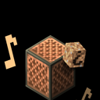

<table width="100%">
  <tr>
    <td width="33%" valign="top">
      
      <a href="https://github.com/polang233/GoodsTrade"><b>GoodsTrade</b></a> 
      简单安全的玩家物品交易插件
    </td>
    <td width="33%" valign="top">
      
      <a href="https://github.com/polang233/NoTime"><b>NoTime</b></a> 
      轻量时间管理与定时任务
    </td>
    <td width="33%" valign="top">
      
      <a href="https://github.com/polang233/HeadSound"><b>HeadSound</b></a> 
      可交互头颅与音符盒音效
    </td>
  </tr>
  <tr>
    <td width="33%" valign="top">
      
      <a href="https://github.com/polang233/TracesDeath"><b>TracesDeath</b></a> 
      遗体墓碑与原槽位取回
    </td>
    <td width="33%" valign="top">
      
      <a href="https://github.com/polang233/VelocityToolbox"><b>VelocityToolbox</b></a> 
      Velocity 热管理与资源包下发
    </td>
    <td width="33%" valign="top">
      
      <a href="https://github.com/polang233/cursor-language-pack"><b>Cursor Language Pack</b></a> 
      Cursor IDE 中文语言包
    </td>
  </tr>
  <tr>
    <td width="33%" valign="top">
      
      <a href="https://github.com/polang233/kiro-language-pack"><b>Kiro Language Pack</b></a> 
      Kiro IDE 中文语言包
    </td>
    <td width="33%" valign="top">
      
      <a href="https://github.com/polang233/TaskEase"><b>TaskEase 轻程</b></a> 
      macOS 进程优先级与 CPU 限制
    </td>
    <td width="33%" valign="top">
      
      <a href="https://github.com/polang233/safari-webrtc-guard"><b>Safari WebRTC Guard</b></a> 
      防 WebRTC 泄露真实 IP
    </td>
  </tr>
</table>
